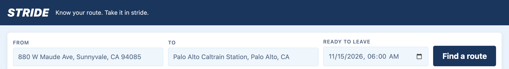
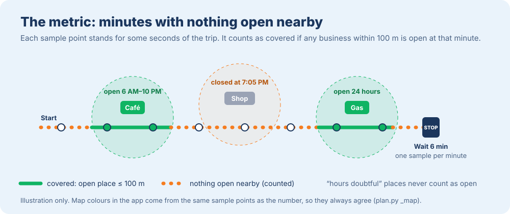
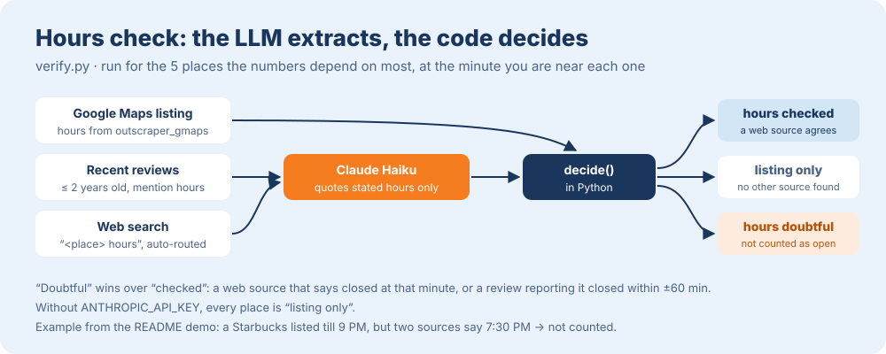

<div align="center">

# STRIDE

**Know your route. Take it in stride.**

Google gives you the fastest bus or train. Stride also shows the route that keeps you **near open businesses** while you walk and wait.

Built at SearchHack (Telem AI), Sunnyvale, 14 Nov 2026



</div>

---

## What it does

For each public-transport option, Stride counts the **minutes with nothing open nearby**. Those are minutes you spend walking or waiting with no open shop, café, restaurant, gas station, pharmacy or grocery store within **100 m** (about a 1-minute walk).

Then it shows two routes side by side:

| Google · fastest | Stride · most open |
|---|---|
| Google's first answer for the trip | The 2 options with the **fewest** minutes with nothing open nearby, even if the trip takes longer |

Stride only reports facts: what's open, what's closed, and whose hours were checked or look doubtful. **It is not a safety rating** and uses no crime or crowd data.

## How it works


1. **Routes** (`app/routes.py`): Google Routes API is asked for transit routes in several ways: the default search, then bus-only, train-only, light-rail-only and rail-only searches, then the same trip leaving 10, 20 and 30 minutes later (only those within `max_extra_minutes`). Duplicate routes are removed. Stride keeps Google's first answer plus up to 11 others that arrive within 60 minutes of the earliest one. Each route is split into **walk / wait / ride** segments with clock times.
2. **Places** (`app/places.py`): For the origin, every stop and the destination, Telem searches Google Maps listings (`outscraper_gmaps`) for 6 business types. It sends 16 queries per call because Telem allows 160 results per call. Places without hours, or not marked operational, are dropped. A small parser reads hours like `7AM-12AM`, `5-8:30p.m.`, `Open 24 hours`, including hours that run past midnight.
3. **Minute by minute** (`app/metric.py`): Walks are sampled about every 80 m and waits once a minute. Each sample is the moment you are at that spot. If no place within 100 m is open at that exact time, its seconds count as *nothing open nearby*.
4. **Hours check** (`app/verify.py`): The 5 places the numbers depend on most are checked against recent Google reviews and an auto-routed web search (see below).
5. **Ranking** (`app/plan.py`): Every route is scored again without the places whose hours are doubtful. If you'd wait at a stop with nothing open nearby, Stride looks for the nearest open place you can walk to, wait inside, and walk back from with 2 minutes to spare. The walks there and back still count; only the time inside is taken off.
6. **Conditions** (`app/conditions.py`): Temperature, rain chance, daylight and US AQI at the start of the trip, from Open-Meteo (no key needed).

### The metric



### Hours check

Listings are often wrong after dark, so Stride doesn't simply trust them for the places that matter.



Claude Haiku only **extracts** the hours each source states, quoting it word for word. Whether a place is open at your minute is decided in Python (`decide()`):

| Badge | Meaning | Counted as open? |
|---|---|---|
| **hours checked** | Listing and at least one web source say open at that minute | Yes |
| **listing only** | Only the Google listing says open | Yes |
| **hours doubtful** | A web source says closed then, or a review reports it closed within 60 min of that time | **No** |

## The results screen

Click **Find a route** and the app shows the steps as it works ("Getting every bus, train and light-rail option…"). A new trip takes 30–90 s; trips you've already run load instantly from the cache. The results show:

- **Info bar**: what "nothing open nearby" means, plus chips for daylight, temperature, rain and AQI.
- **Two tiles**: *Google · fastest* (orange) and *Stride · most open* (navy). Each shows trip time, leave and arrive times, the chain of walks and lines (🚶 5 › 🚌 22 › 🚆 Caltrain), and the minutes with nothing open nearby. You can switch between Stride option 1 and option 2.
- **Map** (Leaflet, Esri light-grey tiles): the selected route drawn bold, the other route faded. Solid lines are walking near something open, dotted lines are walking with nothing open nearby, and green dots are open places. Waits are labelled, with a dashed line to the nearest open place. There are buttons to jump to the start, each wait, and the arrival.
- **Tabs**
  - *Your trip*: step-by-step walk / wait / ride, with the nearest open place at each wait.
  - *Why Stride chose this*: minutes saved compared with Google, less walking, the places you pass, and how much later you arrive.
  - *Other options*: every option compared, sorted by minutes with nothing open nearby.
  - *Evidence*: each place with its badge, today's hours and quoted sources, places that weren't counted and why, and a log of every Telem call made.

## Run it

```bash
python3 -m venv .venv
.venv/bin/pip install -r requirements.txt
cp .env.example .env   # then fill in your keys
.venv/bin/uvicorn app.main:app --port 8000
```

Open <http://localhost:8000>.

### Keys (`.env`, never committed)

| Variable | Used for | Required |
|---|---|---|
| `TELEM_API_KEY` | Telem search: places, reviews, web | Yes |
| `TELEM_BASE_URL` | Defaults to the hackathon router `https://hack.telem.ai/api/router` | No |
| `GOOGLE_MAPS_API_KEY` | Google Routes API (transit) | Yes |
| `ANTHROPIC_API_KEY` | Claude Haiku reads hours from reviews and the web | No (without it every place is "listing only") |

Dependencies: `fastapi`, `uvicorn`, `httpx`, `pydantic`. The front-end is a single HTML file and loads Leaflet from a CDN.

## API

### `POST /api/plan`

```json
{
  "origin": "880 W Maude Ave, Sunnyvale, CA 94085",
  "destination": "Palo Alto Caltrain Station, Palo Alto, CA",
  "end_time": "2026-11-15T06:00",
  "max_extra_minutes": 60
}
```

`end_time` is when you're ready to leave, in local time (America/Los_Angeles). `max_extra_minutes` defaults to 10; the web page sends 60.

The response is shaped like this (example values, shortened):

```jsonc
{
  "options": [            // role: google | stride | stride2 | backup | other
    {
      "label": "Stride option 1", "role": "stride", "same_as_google": false,
      "leave_at": "6:04 AM", "arrive_at": "7:00 AM", "total_minutes": 56,
      "minutes_without_open_door": 9,           // the headline number
      "walk_minutes": 7.5, "wait_minutes": 4.0, "route": "523 → 522", "modes": ["Bus"],
      "segments": [...], "waits": [...], "wait_inside": [...],
      "open_doors": [...], "skipped_places": [...], "map": [...]
    }
  ],
  "notes": ["..."],
  "conditions": { "temp_c": 9.1, "rain_pct": 0, "daylight": false, "aqi": 32 },
  "trace": { "summary": "Checked N Telem calls: ...", "lines": [...], "providers": [...] },
  "radius_m": 100
}
```

Errors: `500` if an environment variable is missing, `502` if an upstream API fails.

## Settings in the code

| Setting | Value | Where |
|---|---|---|
| "Nearby" radius | 100 m | `metric.py` `RADIUS` |
| Walk sample spacing | ~80 m | `routes.py` `sample_points(step_m=80)` |
| Business types | convenience store, restaurant, cafe, gas station, pharmacy, grocery store | `places.py` `CATEGORIES` |
| Places hours-checked per trip | 5 | `plan.py` |
| Review age limit | 2 years | `verify.py` |
| Walking speed / spare time for "wait inside" | 80 m/min · 2 min | `plan.py` `WALK_M_PER_MIN`, `BUFFER_MIN` |
| Options compared | Google's answer + up to 11 more | `plan.py` |

## Code map

```
app/
  main.py        FastAPI: POST /api/plan, serves the page
  plan.py        Gathers options, verifies, ranks, builds the response
  routes.py      Google Routes → timed walk / wait / ride segments, sample points
  places.py      Telem place search, opening-hours parser, open_at()
  metric.py      Minutes with nothing open nearby
  verify.py      Hours check: listing vs reviews vs web, decided in code
  conditions.py  Open-Meteo weather, daylight, AQI
  core.py        .env loading, disk cache, retries (429/503/504), geometry, Telem trace
static/
  index.html     The whole front-end (Leaflet map, tiles, tabs)
docs/images/     README images
```

Every external response is cached on disk in `cache/` (not committed), keyed by the request.

## Demo trips

All from `880 W Maude Ave, Sunnyvale, CA 94085`:

| Ready to leave | To | What it shows |
|---|---|---|
| Sat 14 Nov, 7:00 PM | Santa Clara University, Santa Clara, CA | Google: 25 min trip, 12 min with nothing open. Stride: Bus 21, 41 min trip, 3 min. A Starbucks is not counted: listed till 9 PM, but 2 sources say 7:30 PM |
| Sun 15 Nov, 6:00 AM | Palo Alto Caltrain Station, Palo Alto, CA | Google: 42 min, 25 min with nothing open. Stride: Rapid 523 → 522, 56 min, 9 min |
| Sat 14 Nov, 7:00 PM | San Jose Diridon Station, San Jose, CA | Google's fastest is also the best, and Stride says so |

## Limitations

- **Bay Area only for now**: the time zone is fixed to America/Los_Angeles, and stop names get ", CA" added.
- **Slow first run** (30–90 s) because of many upstream calls. Avoid running several new trips at once (Telem rate limit).
- **The cache never expires.** Delete `cache/` to get fresh routes and hours.
- Hackathon demo using Telem's providers; platform terms would need review before a real launch.
