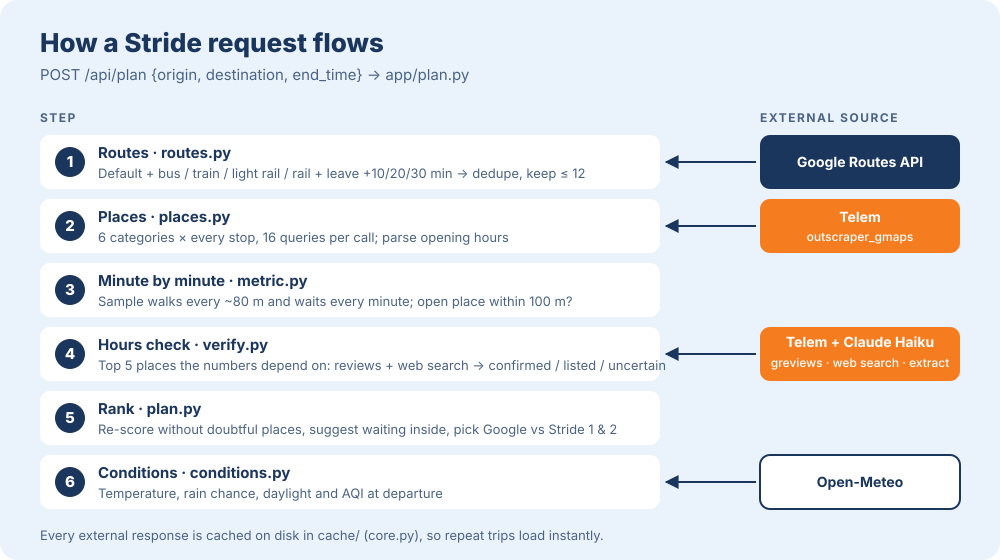

<div align="center">

# STRIDE

**Know your route. Take it in stride.**

Google gives you the fastest bus or train. Stride also shows the route that keeps you **near open businesses** while you walk and wait.

Built at SearchHack (Telem AI), Sunnyvale, 14 Nov 2026


</div>

---

## The idea

For every public-transport option, Stride counts the **minutes with nothing open nearby**. Those are minutes you spend walking or waiting with no open shop, café, restaurant, gas station, pharmacy or grocery store within **100 m** (about a 1-minute walk).

Then it shows Google's fastest route next to Stride's two best routes, the ones with the fewest such minutes, even if they take a little longer.

Stride only reports facts (what's open, what's closed, whose hours were checked). **It is not a safety rating.**

## How it works



1. **Get every route.** Ask Google for transit routes: the default answer, then bus-only, train-only and light-rail-only searches, then later departures. That gives far more options than Google shows by default.
2. **Find open places.** Search for businesses and their opening hours around the start, every stop and the destination (**Telem**).
3. **Check minute by minute.** Follow each route through time. For every minute of walking or waiting, ask: is anything open within 100 m *right now*?
4. **Double-check the hours.** For the few places the result depends on most, compare the listed hours with recent reviews and the web (**Telem**). If any source says the place is closed then, it doesn't count.
5. **Rank.** Pick the routes with the fewest minutes with nothing open nearby. If a wait has nothing open, suggest waiting inside a nearby open place when there's time to walk back.
6. **Add conditions.** Daylight, temperature, rain chance and air quality at departure (Open-Meteo).

### The metric


### The hours check


The AI (Claude Haiku) only **reads** the hours each source states. Whether a place is open at your minute is decided by plain code, never by the AI.

## Where we use Telem

Telem is the search layer behind Stride. All place, review and web lookups go through it:

| What Stride needs | Telem search used | Where in the flow |
|---|---|---|
| Businesses near each stop, with opening hours | Google Maps listings (`outscraper_gmaps`) | Step 2: find open places |
| Recent reviews that mention closing times | Google Reviews (`outscraper_greviews`) | Step 4: hours check |
| Each place's hours stated on the web | Web search with Telem's auto-routing (it picks the best provider) | Step 4: hours check |

Everything else comes from elsewhere: routes from the **Google Routes API**, reading hours from text by **Claude Haiku**, weather and air quality from **Open-Meteo**.

## Example

From Sunnyvale to Santa Clara University at 7 PM on a Saturday:

- **Google:** 25 min trip, **12 min** with nothing open nearby.
- **Stride:** Bus 21, 41 min trip, only **3 min** with nothing open nearby.
- A Starbucks on the way is listed as open till 9 PM, but two sources say it closes at 7:30 PM, so Stride doesn't count it.

When Google's fastest route is also the best one, Stride says so.

## Run it

```bash
python3 -m venv .venv
.venv/bin/pip install -r requirements.txt
cp .env.example .env   # add TELEM_API_KEY, GOOGLE_MAPS_API_KEY, ANTHROPIC_API_KEY
.venv/bin/uvicorn app.main:app --port 8000
```

Open <http://localhost:8000>. A new trip takes 30–90 s; repeated trips load instantly from the cache.

## Limitations

- Bay Area only for now.
- The first run of a trip is slow because of the many searches.
- Hackathon demo; the terms of each data provider would need review before a real launch.
